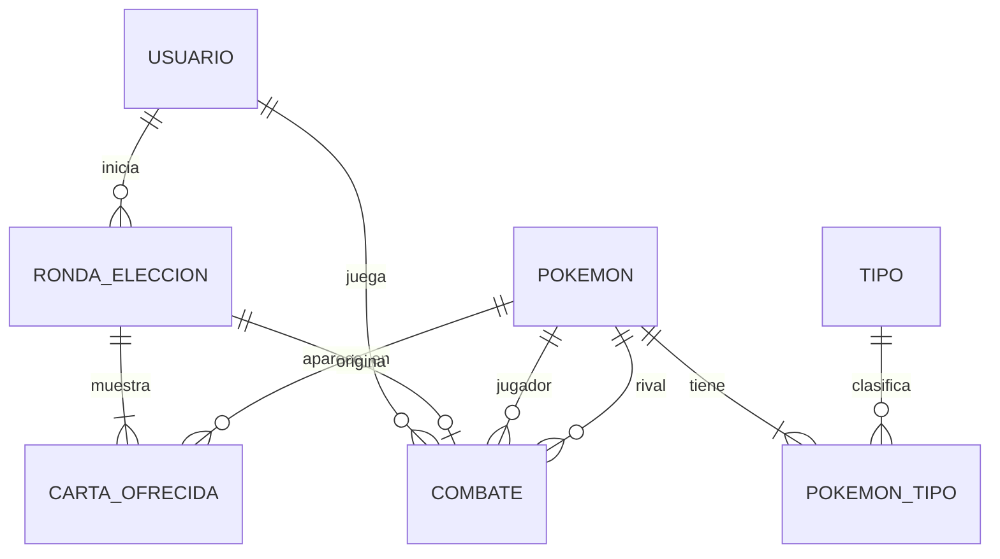

# Diagrama entidad-relación

El PDF `diagrama_pokemon_er_y_flujo.pdf` incluye el diagrama completo y el diagrama de flujo.

| Entidad del diagrama | Clase PHP | Tabla |
|---|---|---|
| USUARIO | `src/Entity/Usuario.php` | `usuario` |
| POKEMON | `src/Entity/Pokemon.php` | `pokemon` |
| TIPO | `src/Entity/Tipo.php` | `tipo` |
| POKEMON_TIPO | ManyToMany en `Pokemon::$tipos` | `pokemon_tipo` |
| RONDA_ELECCION | `src/Entity/RondaEleccion.php` | `ronda_eleccion` |
| CARTA_OFRECIDA | `src/Entity/CartaOfrecida.php` | `carta_ofrecida` |
| COMBATE | `src/Entity/Combate.php` | `combate` |
